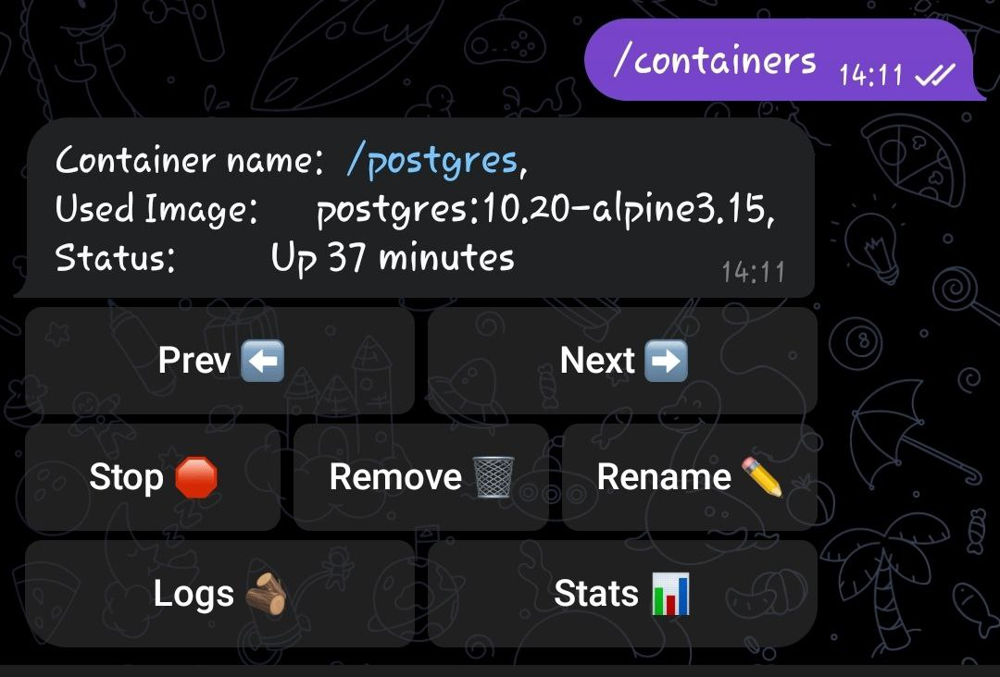
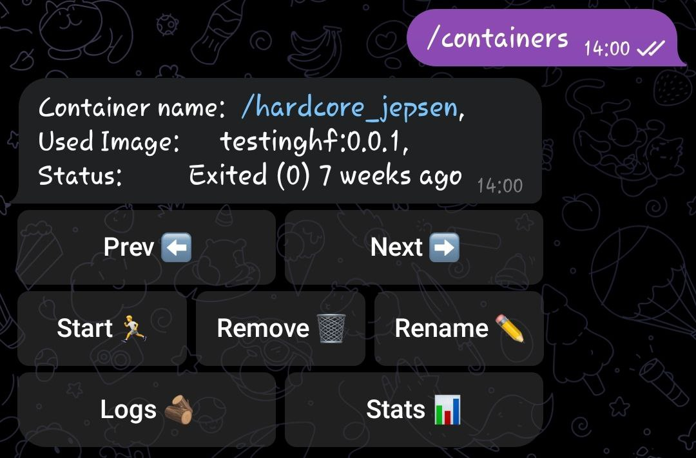
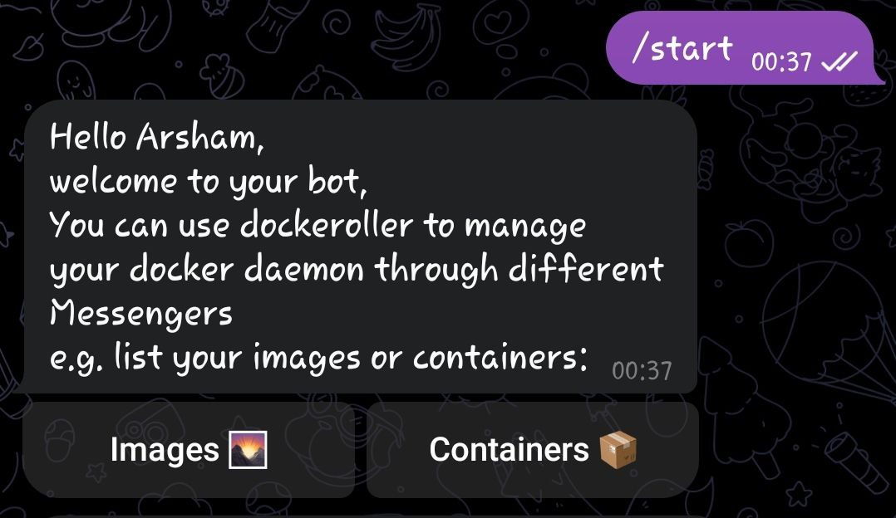

# Dockeroller 🐳
<p align=center>
 <a href="https://codecov.io/github/arshamalh/dockeroller"> 
   
 </a>
</p>

Dockeroller (docker controller) is an open-source project that lets you control your Docker daemon through Telegram. It was made for fun and personal use, but it turned out to have many real-world use cases, and it is part of the ChatOps world!

It is built on [tbb (TBotBase)](https://github.com/arshamalh/tbb), the Telegram bot framework that grew out of this project and its successors.

> [!IMPORTANT]
> Dockeroller is made to run self-hosted, so WE WON'T ACCESS or STORE ANY OF YOUR DATA in any terms. The only data it keeps is the chat sessions, in a local SQLite file.

> [!CAUTION]
> Dockeroller is in Alpha phase and not yet production-ready

## How to use
First make sure you have installed Go 1.25 or above, then run:
````bash
go install github.com/arshamalh/dockeroller@main
````
Then make a bot with [BotFather](https://t.me/BotFather) (its name and username don't matter), copy its `token`, and run:
```bash
dockeroller start --token "<YOUR-TOKEN>" -w <YOUR-CHAT-ID>
```
Your Docker daemon is now accessible through your Telegram bot. Don't know your chat ID? Start without `-w` and message the bot: it answers with your chat ID.

Dockeroller finds the daemon the same way the docker CLI does (`DOCKER_HOST`, `DOCKER_TLS_VERIFY`, `DOCKER_CERT_PATH`), and negotiates the API version, so it works with old and new daemons alike.

### Options
Every flag can also come from the environment or a `.env` file (see [.env.example](.env.example)):

| Flag | Environment | Default | |
|---|---|---|---|
| `--token`, `-t` | `TOKEN` or `TELEGRAM__TOKEN` | | bot token, required |
| `--whitelisted-ids`, `-w` | `WHITELISTED_IDS` | none | comma separated chat IDs allowed to use the bot |
| `--db` | `DB__DSN` | `./dockeroller.db` | sessions database: a SQLite file or a `postgres://` URL |
| `--api-url` | `TELEGRAM__URL` | `api.telegram.org` | e.g. a self-hosted Bot API server |
| `--debug` | | off | verbose logging |

### With Docker
```bash
docker run -d --name dockeroller \
  -v /var/run/docker.sock:/var/run/docker.sock \
  -v dockeroller-data:/data \
  -e TOKEN="<YOUR-TOKEN>" -e WHITELISTED_IDS="<YOUR-CHAT-ID>" \
  arshamalh/dockeroller start
```

## Security
Dockeroller can stop and remove your containers, so it **denies by default**. Only whitelisted chats can use it. Anyone else only gets their own chat ID back (so you can whitelist yourself), and their button presses never reach Docker. Running without a whitelist logs a warning and lets nobody in.

There are no security concerns as long as you keep your Telegram account safe and only whitelist IDs you know:
```bash
dockeroller start -w 22,33,44
```

We will also add a password mechanism soon.

## Features
- [x] Containers
    - [x] List, with Prev / Next
    - [x] Start
    - [x] Stop
    - [x] Pause / Unpause
    - [x] Live logs (the last 20 lines, refreshed every second)
    - [x] Live stats (CPU and memory, computed like `docker stats`)
    - [x] Remove (with force and remove-volumes options)
    - [x] Rename
- [ ] Images
    - [x] List (size, tags, in use / unused / dangling, created at)
    - [x] Remove (with force and prune-children options)
    - [x] Tagging
    - [ ] Run a container from an image

The container view only shows the actions that make sense for its state: Stop and Pause for a running container, Unpause for a paused one, Start otherwise.

## Note for developers and contributors
Each chat has one "panel" message that is edited in place as you navigate, instead of a new message per click.

The containers and images lists are cached in the chat's session (persisted in SQLite, so it survives restarts), and every button carries the index of the item it applies to. The cache is refreshed on list, Next, Back, after an action, and after a final rename or remove. It is not refreshed while a remove form is open, so toggling "Force: false" can't swap the container under your finger. When a button points at an item that is no longer there, the list is refreshed and shown again instead of acting on the wrong container.

Live logs and stats run in the background, one stream per chat. Back, or opening any other view, stops the stream.

### Tests
```bash
make test         # unit and end-to-end tests, no Docker or Telegram needed
make test-docker  # also the integration tests against your Docker daemon
```
The end-to-end tests run the real bot against a fake Telegram Bot API and a fake Docker ([internal/testkit](internal/testkit)). The fake Telegram rejects invalid MarkdownV2 the way Telegram does, so an escaping mistake anywhere fails the suite. The integration tests (`DOCKEROLLER_DOCKER_TESTS=1`) create a throwaway container. `DOCKEROLLER_TEST_IMAGE` picks its image (default `busybox:1.36`).

## Some Screen Shots



